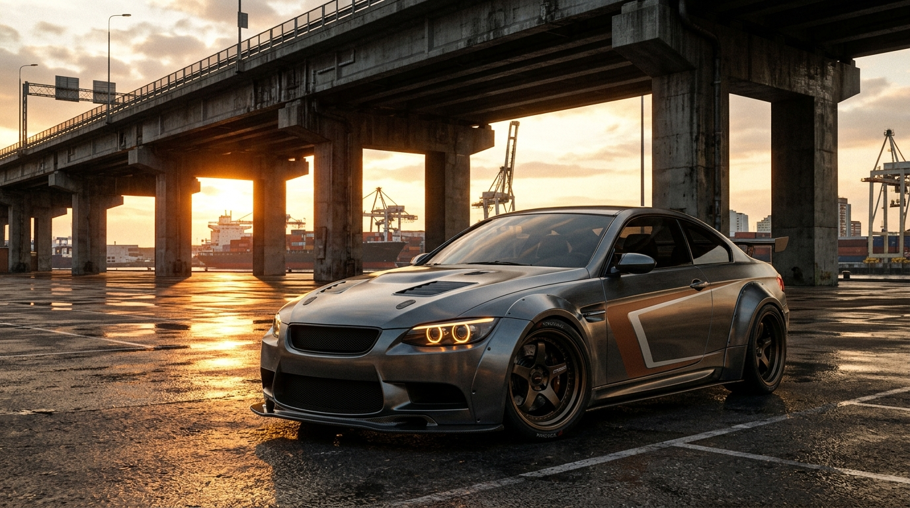
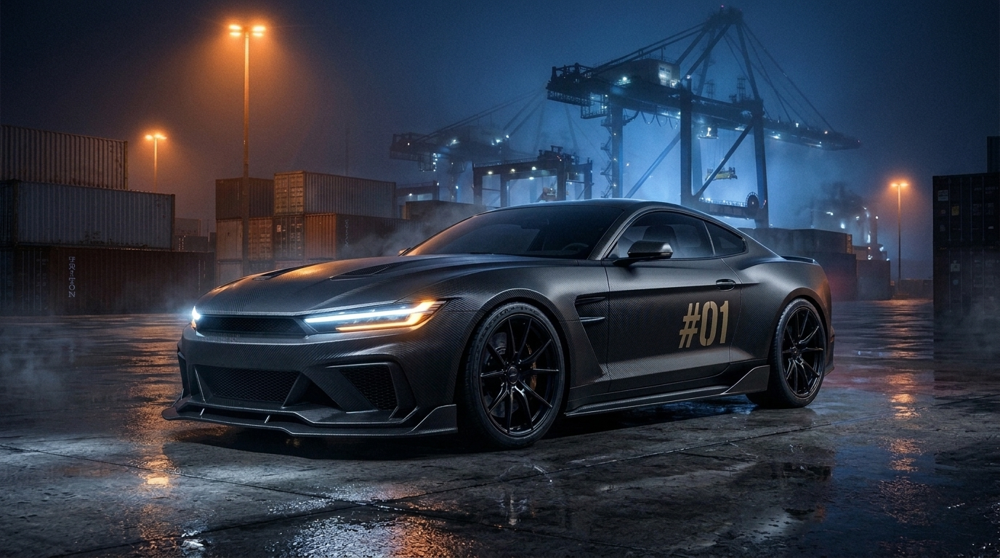
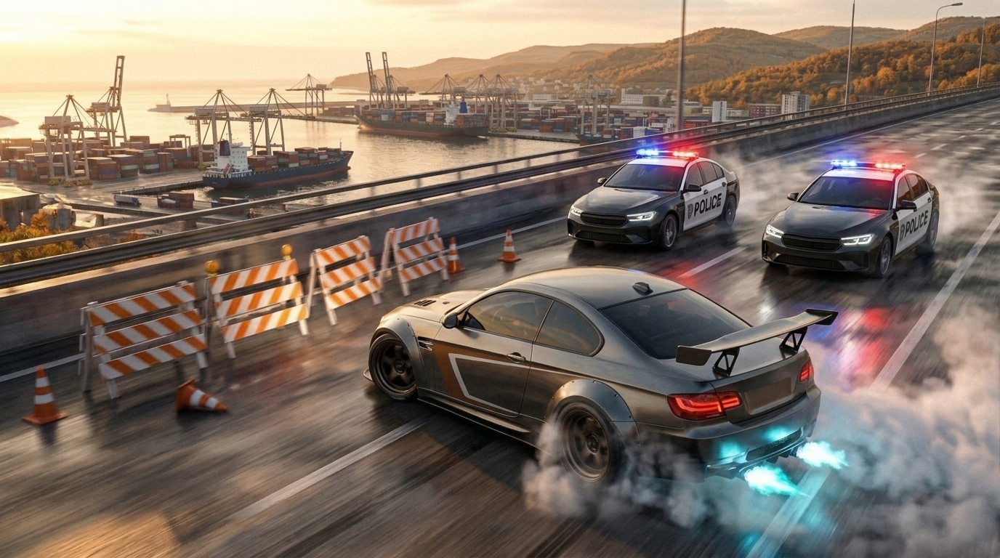
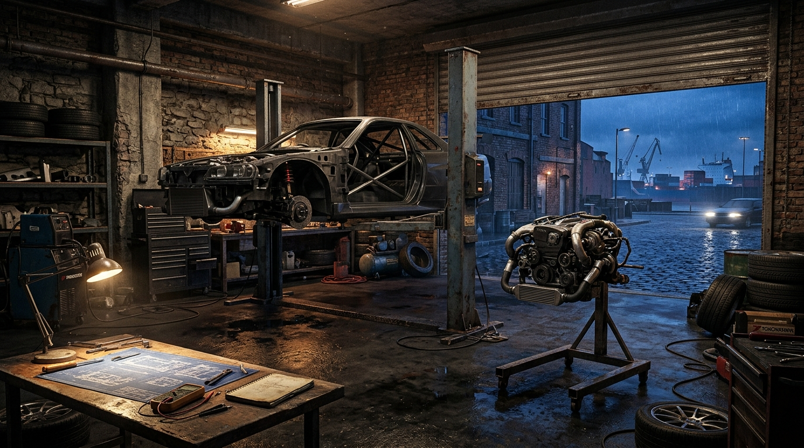

# BLACK NUMBERS — Sanat Yönü ve Özgün Görsel Kimlik

> **Şehir:** **Karamara** *(Port Mara)* · **Ton:** 2005 dönemi sokak yarışı nostaljisi + olgun, acı-tatlı kara film atmosferi.
> **Kural:** Tüm araçlar, markalar, logolar ve şehir dokuları **%100 özgündür**; gerçek dünya otomobil markaları veya amblemleri kullanılmaz.

---

## 1. Dört Görsel Sütun

| Sütun | Tanım | Teknik Karşılık |
|---|---|---|
| **Sonbahar-Kehribar Gündüz** | Yüksek beton viyadükler ve sanayi asfaltı üzerinde sıcak kehribar, hafif puslu öğleden sonra ışığı (`13:00–18:30`) | `BNTimeOfDay::MakeDefaultKeys()` (`Noon` & `Golden hour`) |
| **Sodyum-Kobalt Gece** | Soğuk mavi-kobalt gece sisi içinde turuncu sodyum sokak lambası havuzları (`00:00–05:00`) | `ABNStreetLamp` (sıcak sodyum) + `Night` soğuk gradyanı |
| **Endüstriyel Stencil & Takometre HUD** | Koyu yarı saydam kadran gövdesi, kehribar-altın 24 dilimli kavisli devir yayı, >%85 kırmızı çizgi, siyan NOS ve sıcak gümüş Speedbreaker barı | `ABNHUD::DrawDashboard` (saf Canvas) |
| **Özgün Kurgusal Otomotiv Dili** | Logodan arındırılmış kaslı 2005 dönemi coupe/GT gövdeleri, işlevsel kaput menfezleri, derin ofsetli jantlar ve şasi numarası stencil grafikleri | 16 üyeli özgün marka ailesi (`Kurogane`, `Nocturne`, `Valken`, `Aether` vb.) |

---

## 2. Özgün Konsept Çizimleri

### 2.1 Kahraman Aracı — Kurogane M-Spec (`#00`, K. Vance)

Fırçalanmış koyu kurşuni çelik gövde, yan kapılarda yanık kehribar ve tebeşir beyazı yarış şeridi, bronz 5 kollu derin jantlar ve kehribar angel-ring farlar. Eski Liman ve Kuzey Viyadükleri altında gün batımı atmosferi.

---

### 2.2 Lider Aracı — Nocturne BN-01 (Viktor Serez `#01`)

Mat karbon gövde, agresif ön splitter, ince kesik far imzası ve arka çamurlukta fırçalanmış altın `#01` şasi damgası. Eski Liman konteyner rıhtımında soğuk kobalt sis ve sodyum lambalarının yarattığı kontrast.

---

### 2.3 Karamara Viyadük Kovalamacası (Özel Kademe Konsepti)

Kuzey Viyadükleri üzerinde barikatları yararak geçen Kurogane M-Spec, siyan-mavi NOS egzoz alevleri, yoğun lastik dumanı ve siyah-beyaz polis interceptor araçları.

---

### 2.4 Tarık Kaya'nın Doğu Sanayi Atölyesi (Tier 6 Garaj Konsepti)

Yağ lekeli beton zemin, iki direkli hidrolik liftte şasi hâlindeki yarış aracı, sehpa üzerinde çift turbolu motor bloğu ve sıcak çalışma lambasının aydınlattığı Tier 6 teknik çizimleri; dışarıda yağmurlu liman alacakaranlığı.

---

## 3. Performans ve Bütçe İlkeleri (4 GB VRAM)

- Tüm gerçek zamanlı dünya ve araç aydınlatması **Lumen, Ray Tracing ve Virtual Shadow Maps kapalı** (`DefaultEngine.ini`) olarak tasarlanır.
- Araç farları, stop lambaları, sokak lambaları ve **NOS/Backfire egzoz ışıkları** gölgesiz (`SetCastShadows(false)`) tutularak 1080p düşük-orta donanımda yüksek kare hızı korunur.
- HUD tamamen `UCanvas` çizim ilkelleri (`DrawLine`, `DrawRect`, `DrawText`) ile sıfır ek doku maliyetiyle çizilir.
