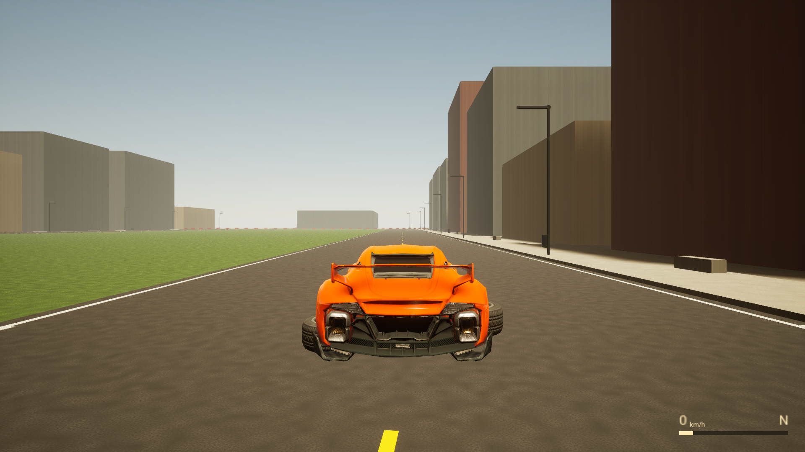
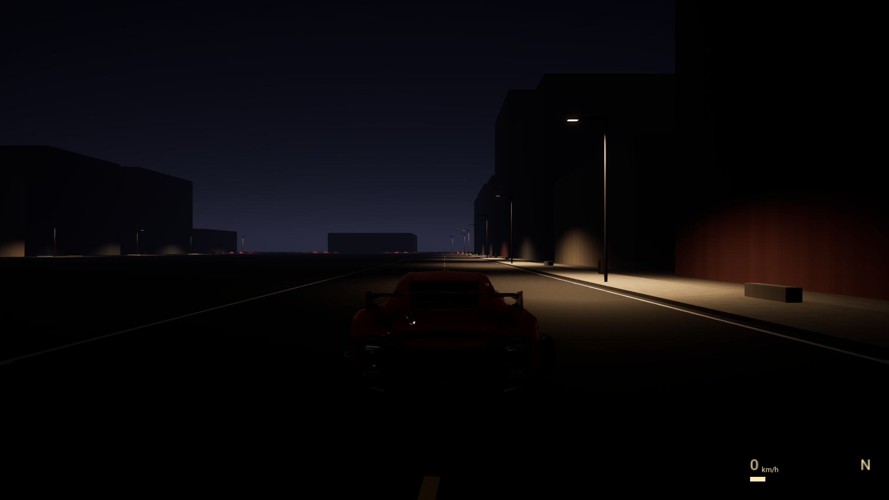
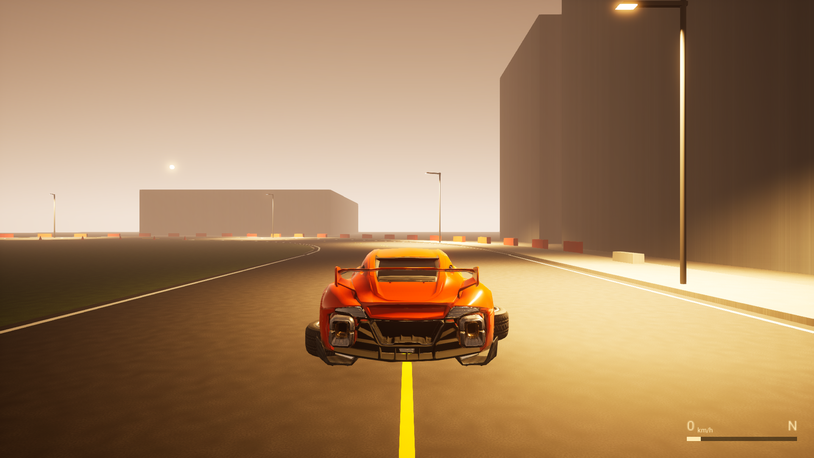
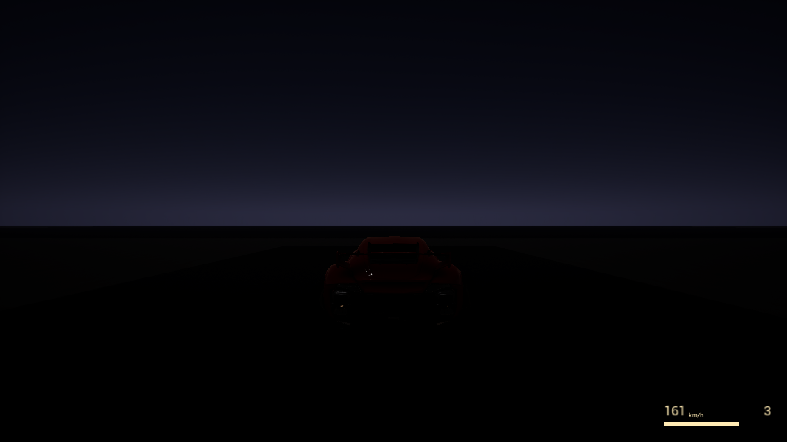

# Faz 1 — İlk Sokak: Durum, Ölçümler ve Test Kaydı

> **Son güncelleme:** 2026-11-17 · Motor: UE 5.8.4 (Linux, Vulkan SM5) · Donanım: i5-11300H, RTX 3050 Ti Laptop 4 GB, 32 GB RAM
> **Durum:** ✅ **Tamamlandı** (2026-11-17). Otomatik kriterler testlerle, drift/kamera/ses kriterleri proje sahibinin sürüş testiyle doğrulandı.

## Kabul Kriterleri

| # | Kriter | Durum | Kanıt |
|---|---|---|---|
| 1 | Oyun açılıyor | ✅ | Editör dışı `-game` çalıştırması (benchmark) ve PIE testleri |
| 2 | Araç oynanabilir | ✅ | `Vehicle.DrivesForward`, `Vehicle.Drift`, `Vehicle.Reverse` |
| 3 | Bitmiş bir sokakta sürülebiliyor | ✅ gri kutu | Oval cadde, kaldırım, lamba, bina, dekor; ekran görüntüleri aşağıda |
| 4 | Yol ve yüzey malzemeleri doğru | ✅ | Görüntüler + `Vehicle.SurfaceGrip` (tekerlek doğru fiziksel malzemeyi bildiriyor) |
| 5 | Lambalar gece-gündüze uyuyor | ✅ | `World.StreetLampsFollowNight` (gece başlangıcında ilk kare dahil) |
| 6 | Hızlanma, fren, direksiyon, geri vites | ✅ | `DrivesForward`, `SurfaceGrip`, `Reverse` |
| 7 | Drift çalışıyor ve **kontrol edilebilir** | ✅ | `Drift`, `DriftExitAccelerates`, `HandbrakeNoSpin` + proje sahibinin sürüş testi |
| 8 | Kamera normal sürüşte ve drift'te doğru | ✅ | Proje sahibinin sürüş testi |
| 9 | Motor sesi araca tepki veriyor | ✅ | `EngineSoundMapping`, `DashAndAudioFollowCar` + proje sahibinin sürüş testi (hışırtı düzeltildi) |
| 10 | Hız göstergesi doğru | ✅ | `DashAndAudioFollowCar`: gösterge hızı/vitesi/devri fizik durumuyla aynı; HUD görüntülerde çiziliyor |
| 11 | Faz 0 bozulmadı | ✅ | `World.TimeOfDay`, `DrivesForward` |
| 12 | Otomatik testler geçiyor | ✅ | 9/9 (aşağıda) |
| 13 | Performans ölçülüp belgelendi | ✅ | Aşağıda |
| 14 | Sonraki fazlarla uyumlu | ✅ | Ayarlar editörden düzenlenebilir; oynanış kodu grafik ayarından bağımsız |

## Elle Test Talimatları

Editörü aç, sağ alttaki "Compiling Shaders" sayacı bitene kadar bekle, **Play**'e bas.

1. **Drift hissi (7):** Başlangıçtan düz git, pistin sonundaki kayma pistinde 60-80 km/s'ye çık. Direksiyonu kır, Boşluk'a kısa bas, bırak. Gazla kaymayı tutmaya, kontra kırmaya çalış.
   *Beklenen:* Arka taraf kontrollü kayar, kontra ile drift tutulabilir, gaz kesilince araç düzelir. Spin kolay olmamalı.
2. **Kamera (8):** Normal sürüşte ve drift'te kamera sarsılmamalı, drift'te gidiş yönüne doğru hafifçe dönmeli. C ile yakın/uzak geçişi çalışmalı.
3. **Ses (9):** Rölantide alçak bir uğultu, gazla yükselen ve devirle tizleşen motor sesi, vites geçişinde perdede düşüş, drift'te lastik sürtünme sesi duyulmalı.
4. **Gece:** Konsolda `bn.SetTime 22`. Lambalar yanmalı, cadde karanlık ama lamba havuzları okunmalı.

Ayar gerekirse (editörde `BNVehiclePawn` ve harita içindeki `DayNightCycle` aktörü üzerinde):

| His | Ayar |
|---|---|
| Drift çok kolay / zor | `Handling → Drift → RearGripScale` (0,45; düşük = daha kaygan) |
| Drift'ten çıkış hızı | `Drift → GripRecoverSeconds` (1 sn; Space bırakılıp direksiyon düzeltilince arka tutuşun geri gelme süresi) |
| Kamera | `Camera → ChaseDistances`, `DriftCameraBlend`, `BaseFov/MaxFov` |
| Ses seviyesi | `EngineAudio → MasterGain` |
| Gece karanlığı | `DayNightCycle → Look → NightMinExposureEV100` (3; düşük = daha aydınlık gece) |

## Otomatik Testler

`Tools/run_tests.sh` derler ve hepsini çalıştırır. Son çalıştırma: **11/11 geçti** (2026-11-17).

| Test | Ne doğrular | Son ölçüm |
|---|---|---|
| `World.TimeOfDay` | Saat matematiği, pozlama tabanının güneşe bağlı geçişi | — |
| `World.LightsFollowNight` | Gece başlatılınca sokak lambaları ve araba farları **ilk karede** yanık; öğlen sönük; gece tekrar yanık | 26 lamba + far/stop |
| `Vehicle.WheelsAligned` | Sürüşte dört tekerlek de arabanın yan ekseninde dönüyor, jantlar dışa bakıyor | hizalama 1,0000 |
| `Vehicle.DriftExitAccelerates` | Drift'te Space bırakılıp direksiyon düzeltilip tam gaz verilince araç hızlanır | +26,5 km/s / 2,5 sn |
| `Vehicle.HandbrakeNoSpin` | 80 km/s'de tam kırma + W basılıyken 1,5 sn el freni: spin yok, bırakınca toparlanıyor (30/60 FPS'te de) | en fazla ~33° |
| `Vehicle.DrivesForward` | Araç doğuyor, 0-100 süresi 4,5-8 sn, düzlükte zıplama yok, virajda kayma sınırlı | 0-100 **5,48 sn**, dikey 10,8 cm/s, kayma 1,5° / 12,6° |
| `Vehicle.Drift` | El freni + direksiyonla drift başlar (>20°), gaz + kontra ile ≥1 sn tutulur, spin yok (<75°), gaz kesince ≤3 sn'de tutuş | 20,9°, 2,44 sn tutuldu, tutuş 0,26 sn |
| `Vehicle.Reverse` | Dururken fren = geri vites, geri hız sınırı | **-25,8 km/s**, vites R |
| `Vehicle.SurfaceGrip` | Tekerlek doğru fiziksel malzemeyi görüyor; frenleme asfalt > toprak > çim | 1,34 g / 0,86 g / 0,64 g |
| `Vehicle.EngineSoundMapping` | Devir → perde, gaz → ses yüksekliği, kayma → lastik sesi (birim testi) | rölanti 45 Hz |
| `Vehicle.DashAndAudioFollowCar` | Gösterge hızı, vitesi ve devri fizik durumuyla aynı; ses perdesi devre bağlı; gaz kesince ses azalıyor | 60 / 60,7 km/s, 4302 rpm |

## Regresyon Kontrol Listesi

| Madde | Nasıl doğrulanır |
|---|---|
| Derleme | `Tools/run_tests.sh` (derlemeyle başlar) |
| Araç doğuyor | `DrivesForward`, ortak `StartTestTrack` |
| Gaz tepkisi | `DrivesForward` (0-100) |
| Direksiyon tepkisi | `DrivesForward` (tam kırma), `Drift` |
| Fren | `SurfaceGrip` |
| Geri vites | `Reverse` |
| Drift | `Drift` (başlatma, sürdürme, spin yok), `HandbrakeNoSpin` |
| Tutuşa dönüş | `Drift` (son aşama) |
| Gösterge doğruluğu | `DashAndAudioFollowCar` |
| Ses parametreleri | `EngineSoundMapping`, `DashAndAudioFollowCar` |
| Gece-gündüz geçişi, ilk kare ışığı | `TimeOfDay`, `LightsFollowNight` |
| Lambalar ve farlar | `LightsFollowNight` |
| Tekerlek montajı | `WheelsAligned` + benchmark yan görüntüleri |
| Yüzey davranışı | `SurfaceGrip` |
| Harita yükleme | Her PIE testi `/Game/Maps/TestTrack` yükler |
| Temel performans | `Tools/benchmark.sh` (elle; ~2 dk, GPU gerekir) |
| Görsel kontrol | `Tools/benchmark.sh` ekran görüntüleri: `Saved/Screenshots/LinuxEditor/` |

## Performans

`Tools/benchmark.sh` → `bn.Benchmark`. Editör ikilisinin `-game` modu (bağımsız oyun, **paketlenmiş Shipping derleme değil**), 1920×1080, proje "Düşük" ön ayarı, VSync kapalı, ekran dışı çizim. Her sahne: 3 sn ısınma, 10 sn ölçüm.

| Sahne | Ort. FPS | Ort. ms | p50 | p95 | p99 | >16,7 ms | Oyun ms | Render ms | GPU ms |
|---|---|---|---|---|---|---|---|---|---|
| Cadde, gündüz | 214 | 4,67 | 4,60 | 5,56 | 6,42 | %0 | 2,58 | 2,04 | 4,26 |
| Cadde, gece (26 lamba) | 208 | 4,80 | 4,76 | 5,42 | 6,24 | %0 | 2,52 | 1,57 | 4,40 |
| Viraj, gün batımı | 212 | 4,72 | 4,66 | 5,29 | 7,06 | %0 | 2,46 | 1,31 | 4,31 |
| Pistte tam gaz, gece | 228 | 4,39 | 4,31 | 4,91 | 6,85 | %0 | 2,63 | 1,43 | 3,96 |

- **VRAM:** cihazın tamamında en yüksek 899 MiB (`nvidia-smi`, masaüstü dahil). 4 GB'lık kartta geniş pay var.
- **Darboğaz:** GPU (~4,3 ms), ardından oyun iş parçacığı (~2,5 ms). 60 FPS bütçesinin (16,7 ms) dörtte biri kullanılıyor.
- **Unreal Insights:** `Saved/Benchmark/bn.utrace` (Insights ile aç). Ayrıntılı darboğaz analizi henüz yapılmadı.
- **Editör içi (PIE) performans ölçülmedi.** Tablodaki rakamlar yalnızca bağımsız oyun içindir.
- **Sınırlar:** Windows/DX12 ve paketlenmiş derleme ölçülmedi. Sahnelerin üçü duran araçla, biri sürüşle. Ekran dışı çizim, pencere sunumu (compositor) maliyetini içermez.

### Ekran Görüntüleri (benchmark)

| Gündüz | Gece |
|---|---|
|  |  |
| **Gün batımı, viraj** | **Pist, gece, 160+ km/s** |
|  |  |

## Araç Fiziği Mimarisi

- **Chaos Vehicles** (`UChaosWheeledVehicleMovementComponent`) korunuyor. Özel bir hareket kodu yok.
- `ABNVehiclePawn`: görünmez tekerlek iskeleti (`SKM_SportsCar`) + statik gövde, cam ve tekerlek modelleri; takip kamerası; kodla kurulan Enhanced Input.
- Motor: 400 Nm, 7000 rpm, kendi tork eğrisi (boş kalırsa Chaos motoru kapatır), 5 ileri otomatik vites, geri vites sınırı 35 km/s.
- Lastik: ön 2,0 / arka 2,2 sürtünme çarpanı; tüm tekerlekler ABS, arkada patinaj önleyici; hıza duyarlı direksiyon eğrisi (MPH).
- **Drift yardımı** (`FBNDriftTuning`): hızlıyken el freni basılıyken arka tutuş ×0,45'e iner ve arka patinaj önleyici kapanır. Bırakınca tutuş 1 sn'de tam değere döner; sürücü kontra kırıyorsa (direksiyon kayma yönünde) bekler ve drift sürer. El freni arka ABS'yi devre dışı bırakır. Kaymanın kendisi Chaos fiziğidir, betiklenmiş hareket yoktur.
- Yüzeyler: `PM_Asphalt` 1,0, `PM_Concrete` 0,85, `PM_Dirt` 0,6, `PM_Grass` 0,45. Chaos bu sürtünmeyi tekerlek tutuşuna doğrudan uygular.
- Fizik 30 FPS altında ağır çekime geçer (motorun 1/30 sn fizik adımı sınırı). Async sabit adım denendi, bu davranışı değiştirmediği için geri alındı.

## Düzeltilen Hatalar (kullanıcı testi, 2026-11-17)

| Şikâyet | Kök neden | Düzeltme | Koruyan test |
|---|---|---|---|
| Tekerlekler ters takılı | Tekerlek kemikleri bileşen uzayında (Y -90, R 90) dönük; telafi edilmemişti. Sol/sağ yön de tersti. Tekerlekler dönerken para gibi yalpalıyordu | Kemik dinlenme dönüşünün tersi + sol tekerleklere 180° | `WheelsAligned` |
| Space'e basınca araç "kafayı yiyor" | Fizikte spin üretilemedi (30/60/sınırsız FPS). En olası sebep yalpalayan tekerlekler ve sert drift kamerası | Tekerlekler düzeltildi, drift kamerası yumuşatıldı (0,5 → 0,3) | `HandbrakeNoSpin` |
| Bazı yerlerde çimen sesi | Ses sentezinde iki gürültü katmanı (motor pürüzü, lastik) hışırtı gibi duyuluyordu; düşük hızda gövde kayma açısı da tetikliyordu | Gürültü kaldırıldı, lastik sesi tonlu cıyaklama; yalnızca yerdeyken, 15 km/s üstünde, 10° üstü kaymada | `EngineSoundMapping` |
| Gece farlar yok | Yoktu | Gece kendiliğinden yanan farlar ve stop lambaları | `LightsFollowNight` |
| Drift'te Space bırakınca hızlanamıyorum | Drift tutuşu kayma 6°'nin altına inene kadar sürüyordu; gaz arkayı boşa döndürüp kaymayı besliyordu (55 → 21 km/s) | Drift tutuşu el frenine bağlı; bırakınca 1 sn'de geri gelir, kontra kırılıyorsa drift tutulur | `DriftExitAccelerates` |

## Bilinen Sınırlar

- Sokak lambaları ve dekor kırılmaz (yol haritası Faz 3).
- Araba motorun şablonundaki geçici spor araba. Lisans: Unreal Engine EULA kapsamında, UE projelerinde kullanılabilir.
- Çevre gri kutu: pencere, tabela ve gece ışıklı bina cephesi yok. Dekor basit şekillerden.
- Drift hissi yalnızca betikle ölçüldü. Drift sırasında hız kaybı belirgin (70 → ~37 km/s).
- Frenleme 1,34 g: performans lastikli spor araba seviyesinde, sıradan bir araba için yüksek.
- Motor sesi tamamen sentez. Ses kalitesi kulakla değerlendirilmedi. Kamera sarsıntısı (isteğe bağlı) eklenmedi.
- Araç ayarları pawn ve hareket bileşeni üzerinde, editörden düzenlenebilir. Araç başına veri varlığı (Data Asset), birden fazla araba gelince (Faz 5) eklenecek.
- Harita betikle üretilir. Editörde elle yapılan değişiklikler bir sonraki `Tools/build_map.sh` ile kaybolur.
- Proje yolundaki `ü` harfi: Unreal Insights iz dosyası bu yolu bozuyor; `benchmark.sh` izi `/tmp`'ye yazıp taşıyarak çözüyor.

## Faz 2 Öncelik Önerisi

1. Yukarıdaki elle testlerden gelen ayarlar (drift, kamera, ses).
2. Yarış altyapısı: kontrol noktaları, geri sayım, bitiş, sonuç (oval cadde ilk Pist rotası olur).
3. Drift puanlaması: `GetSlipAngleDegrees()` ve `IsDrifting()` hazır.
4. Rakip yapay zekâ: yarış çizgisi spline'ı, oval caddeden başlayarak.
